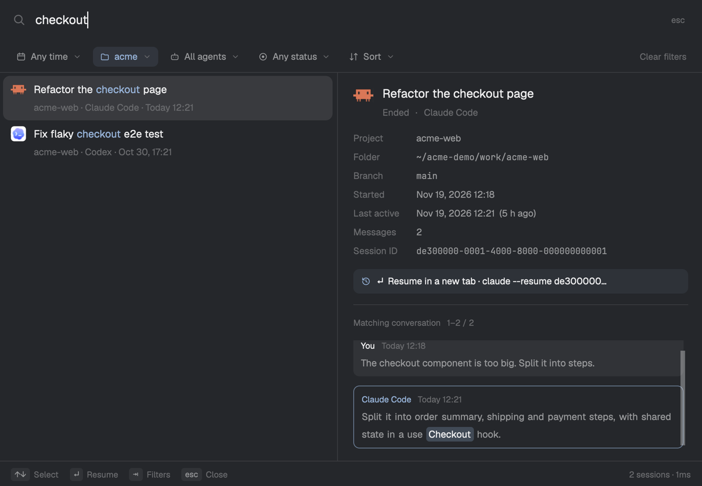
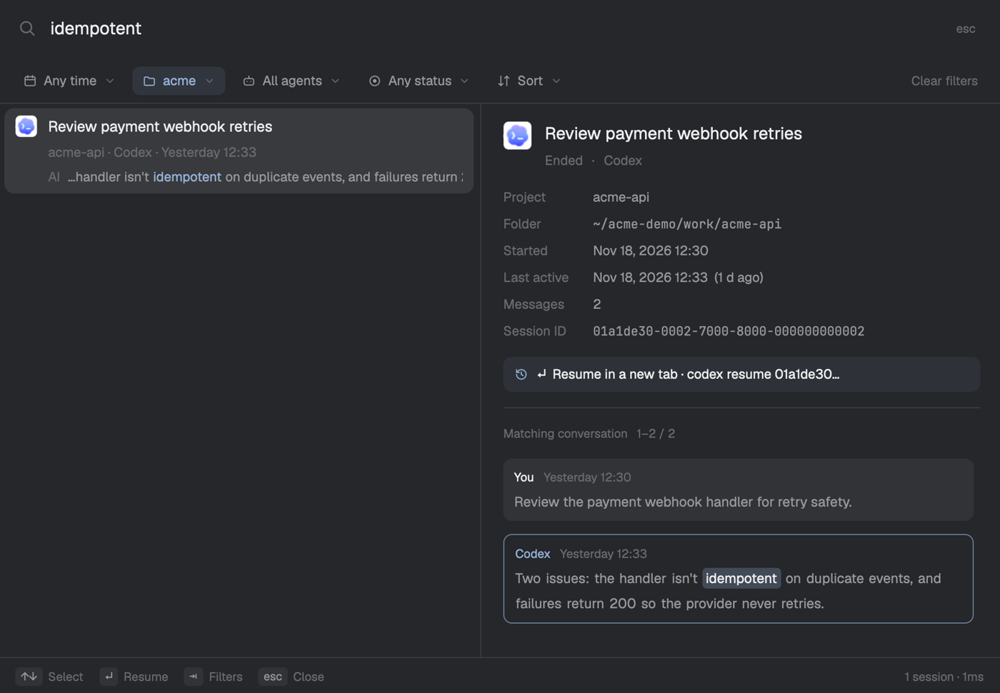
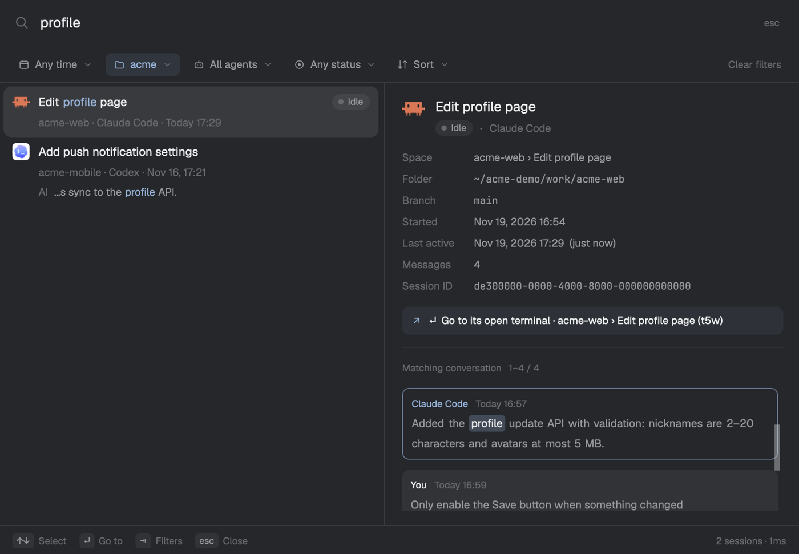
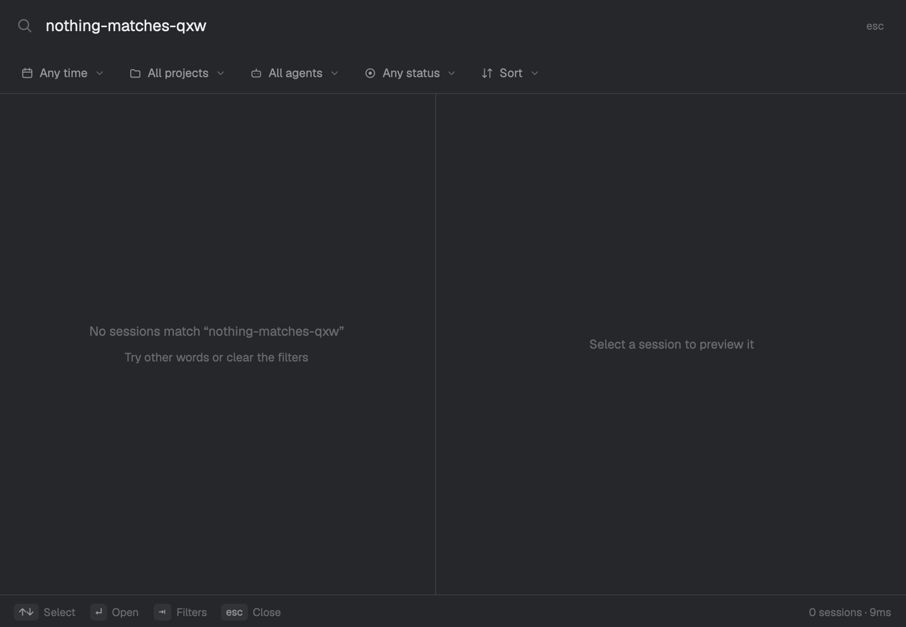

# Herdr Session Spotlight

Claude Code와 Codex의 **실행 중·종료된 세션을 한 검색창에서 찾고, 그 세션으로 바로 돌아가는** Herdr App Mod입니다.
`Cmd+K`로 열고, 세션 제목·대화 내용·프로젝트·폴더·날짜·에이전트로 검색합니다. 실행 중인 세션은 정확한
터미널로 포커스하고, 종료된 세션은 원래 작업 디렉터리에서 공식 재개 명령(`claude --resume`, `codex resume`)으로 이어갑니다.

> A Spotlight-style search for every Claude Code and Codex session on this computer, inside the Herdr app.
> Running sessions are focused by their exact terminal address; ended ones resume in their own folder.
> Everything is indexed locally (SQLite FTS5); nothing leaves the machine.


## 기능

| | |
|---|---|
| **통합 검색** | 세션 제목, 사용자 메시지, 에이전트 응답, 프로젝트/Space, 작업 디렉터리, 브랜치, 에이전트 종류 |
| **검색 방식** | 부분 문자열(한글 조사·어미 포함 — "프로필"이 "프로필을"을 찾음), 여러 단어 AND, 따옴표 구문, 대소문자 무시, 하이라이트, 관련도 정렬(제목 일치 가중치) |
| **최근 세션** | 검색어 없이 열면 *실행 중* → *최근 세션* 순으로 마지막 활동 기준 정렬. 생성일과 마지막 활동일을 구분해 표시 |
| **필터 칩** | 기간(오늘 / 7일 / 30일 / 전체 / 사용자 지정), 프로젝트·Space, 에이전트(Claude / Codex / 기타), 상태(실행 중 / 종료됨), 정렬(자동 / 최근 활동 / 생성일 / 관련도 / 오래된순) |
| **검색 연산자** | `project:acme-web` `agent:codex` `after:2026-11-01` `before:2026-11-10` `after:7d` `status:running` `sort:created` |
| **미리보기** | 메타데이터(프로젝트, 디렉터리, 브랜치, 시작/마지막 활동, 메시지 수, 세션 ID), Enter가 할 일, 일치한 메시지로 스크롤된 대화 |
| **세션 열기** | 실행 중 → 해당 Space·탭·pane으로 이동(새 세션을 만들지 않음). 종료됨 → 원래 폴더에서 재개(그 Space가 있으면 새 탭, 없으면 새 Space) |

| 제목 검색 | 본문 검색 |
|---|---|
|  |  |

| 필터 메뉴 | 실행 중 세션으로 이동 |
|---|---|
|  |  |

| 결과 없음 | 기록이 삭제된 세션 |
|---|---|
|  |  |

## 단축키

| 키 | 동작 |
|---|---|
| `Cmd+K` | 열기 / 닫기 (Herdr 전역 단축키, `keys.json`) |
| 입력 | 즉시 검색 (60ms 디바운스) |
| `↑` `↓` / `PageUp` `PageDown` | 결과 선택 |
| `Enter` | 실행 중이면 그 터미널로 이동, 종료됐으면 재개 |
| 클릭 | 선택, 선택된 행을 다시 클릭하면 열기 |
| `Tab` / `Shift+Tab` | 필터 칩 메뉴를 차례로 열기 (메뉴 안: `↑` `↓` 선택, `Enter` 적용, `←` `→` 옆 칩) |
| `Esc` | 메뉴 닫기 → 모달 닫기 |

## 설치

요구 사항: Herdr App(아래 검증 버전), `python3` 3.9+ (SQLite 3.34+ / FTS5 trigram), macOS. 외부 패키지 없음.

```sh
git clone <this repo> herdr-session-spotlight
cd herdr-session-spotlight
scripts/install.sh                 # 다른 키: scripts/install.sh --key cmd-shift-o / 키 없이: --no-key
```

`install.sh`가 하는 일:

1. `session-spotlight/mods/session-spotlight/` → `~/.config/herdr-app/mods/session-spotlight/` 복사
   (같은 이름의 다른 Mod가 있으면 중단)
2. `keys.json`에 `"cmd-k": "mod.open:session-spotlight"` **한 줄만** 추가
   (먼저 `keys.json.spotlight-backup-<시각>`으로 백업, 이미 다른 동작에 쓰는 키면 복사 전에 중단.
   심볼릭 링크로 관리하는 `keys.json`은 대상 파일을 권한 그대로 수정. 추가한 바인딩은
   `~/.config/herdr-session-spotlight/installed-keys.json`에 기록해, 삭제 때 그것만 지움)

> **단축키 충돌 주의**: 다른 앱이 macOS 전역 단축키로 잡은 키는 Herdr까지 오지 않습니다.
> 예를 들어 Notion 데스크톱 앱은 `Cmd+Shift+K`를 전역 검색에 쓰기 때문에 처음 정했던 이 키를 `Cmd+K`로 바꿨습니다.
> Slack·Notion 등의 `Cmd+K`는 그 앱 안에서만 동작하므로 충돌하지 않습니다.
3. `spotlight.py doctor`(Python/SQLite/FTS5 확인)와 `herdr-app check` 실행

인덱스는 처음 열 때 만들어집니다(이 개발 환경 기준 Claude 175 + Codex 32 세션, 약 3초).

Herdr에게 맡기려면: *"~/.config/herdr-app/AGENTS.md를 읽고 이 Mod를 추가해줘: <repo>/session-spotlight"*
(`session-spotlight/RECIPE.md`가 Gallery 형식의 빌드 설명서입니다.)

### 삭제

```sh
scripts/uninstall.sh            # Mod 폴더 + 이 스크립트가 추가한 단축키만 제거 (keys.json은 백업 후 수정)
scripts/uninstall.sh --purge    # 로컬 인덱스와 설정까지 제거
```

Claude Code·Codex의 원본 기록은 설치·삭제·인덱싱 어느 단계에서도 수정하지 않습니다.

## 구조

```text
session-spotlight/mods/session-spotlight/
├── main.js            Spotlight UI (gpui-kit View) · 키보드 · 필터 · 미리보기 · 열기/재개
├── lib.js             순수 로직: 시간 포맷, 필터→인자, 라이브 터미널 수집, 내비게이션 계획
├── mod.json           place: none + 중앙 dialog overlay (920×640)
├── icons/             자체 SVG 아이콘
└── engine/            Session Search Service (Python 표준 라이브러리만)
    ├── spotlight.py           진입점: index | search | resolve | preview | check | stats | reset | doctor
    └── spotlight_engine/
        ├── adapters.py        Claude / Codex 기록 어댑터 (읽기 전용)
        ├── indexer.py         증분 인덱서 (바이트 오프셋, 단일 실행 잠금)
        ├── store.py           SQLite 스키마 (sessions · messages · messages_fts(trigram) · herdr_seen)
        ├── search.py          쿼리 파서·연산자·필터·점수·스니펫·미리보기·재개 판정
        ├── live.py            Herdr Live Sessions: 실행 중 터미널 → 세션 ID (프로세스 기준)
        ├── redact.py          비밀값 마스킹
        └── textutil.py        하이라이트·스니펫
```

자세한 설계와 조사 결과: [docs/DESIGN.md](docs/DESIGN.md) · 검증 결과: [docs/VERIFICATION.md](docs/VERIFICATION.md)

### 세션 식별과 실행 중 판정

세션 키는 `머신|에이전트|세션ID`(현재 머신은 `local`)입니다. 실행 중인 터미널과 기록은 **제목이나 프로젝트 이름으로 연결하지 않고 프로세스로 연결**합니다.

- **Claude Code**: 터미널의 포그라운드/하위 프로세스 pid → `~/.claude/sessions/<pid>.json`의 `sessionId`.
  파일의 `procStart`가 실제 프로세스 시작 시각(`ps -o lstart`, UTC)과 같을 때만 인정해, pid 재사용으로 남은 파일을 무시합니다.
- **Codex**: 실행 중인 codex 프로세스가 열어 둔 `~/.codex/sessions/.../rollout-*-<id>.jsonl`(`lsof`).
- 둘 다 실패하면 포그라운드 명령의 `--resume <uuid>` / `resume <uuid>`.
- 하위 에이전트(pane 없는 `hc run` 자식)는 Herdr처럼 **부모 터미널의 탭**에 속한 것으로 표시합니다.

Enter를 누를 때마다 실행 중 터미널을 **새로 조회**한 뒤 결정합니다(목록의 이전 결과를 믿지 않음).

- 그 세션을 가진 터미널이 있으면 `space.select → tab.select → pane.focus {terminal: <정확한 주소>}`로 이동합니다. 이름이 같은 Space가 여러 개여도 혼동하지 않습니다.
- 없으면 기록 파일·작업 폴더를 확인한 뒤 재개합니다.
- 다음 경우에는 **아무것도 실행하지 않고** 이유를 표시합니다(중복 실행보다 거절이 낫다는 원칙).
  - 조회가 실패했거나 일부 터미널이 답에서 빠짐
  - 같은 에이전트인데 세션을 식별하지 못한 터미널이 있음(예: 폴더 신뢰 화면에 멈춘 Claude, 열린 rollout이 여럿인 Codex)
  - 세션을 가진 터미널로 이동할 수 없음
  - 확인하는 동안 터미널 구성이 바뀜

## 인덱스와 보안 정책

- **저장 위치**: `~/.local/share/herdr-session-spotlight/index.sqlite3` (`$XDG_DATA_HOME` 존중). 폴더 `0700`, 파일 `0600`.
- **설정**: `~/.config/herdr-session-spotlight/config.json` (선택, 없으면 기본값). `spotlight.py init-config`로 기본 파일 생성.

  ```json
  {
    "exclude_paths": ["~/Documents/company-secret", "/private/tmp/*"],
    "agents": ["claude", "codex"],
    "index_assistant": true,
    "include_subagents": false,
    "include_archived": true,
    "max_message_chars": 6000
  }
  ```
  `exclude_paths`에 걸리는 폴더에서 시작된 세션은 인덱싱하지 않고, 나중에 추가하면 기존 항목도 지웁니다.
- **인덱싱 대상**: 사용자 메시지와 에이전트 텍스트 응답만. 도구 호출·도구 결과(파일 내용, 명령 출력)·thinking·첨부·환경/지침 블록(`<system-reminder>`, `AGENTS.md` 지침, `<environment_context>` 등)은 **제외**합니다.
- **비밀값 마스킹**: 저장 전에 API 키(`sk-…`, `AKIA…`, `ghp_…`, `xox…`, `AIza…`, JWT, PEM 개인키), `Bearer` 토큰, `password=`/`api_key:`/`"password": "…"`(JSON) 형태의 값, URL 속 비밀번호를 `[REDACTED]`로 바꿉니다. 메시지·제목·첫/마지막 프롬프트·증분 인덱싱용 파서 상태에 모두 적용하고, 프롬프트는 자르기 **전에** 마스킹합니다. 제외·스킵된 기록은 파서 상태도 남기지 않습니다.
- **네트워크**: 사용하지 않습니다. Mod는 로컬 `python3` 프로세스만 실행합니다(`exec`).
- **권한**: 전체 디스크 접근 권한이 필요 없습니다. 읽는 곳은 `~/.claude/projects`, `~/.claude/sessions`, `~/.codex/sessions`, `~/.codex/archived_sessions`, `~/.codex/session_index.jsonl` 뿐입니다.
- **삭제·재생성**: `python3 ~/.config/herdr-app/mods/session-spotlight/engine/spotlight.py reset --yes` 후 모달을 열면 다시 만듭니다. `index --full`은 즉시 전체 재구축.
- **원격 머신**: 수집하지 않습니다(아래 제약 참고).

## 지원 버전 (검증한 환경)

| 구성 요소 | 버전 |
|---|---|
| Herdr App | 0.1.16 (herdr-core `hc` 0.1.21), macOS (Darwin 25.6, Apple Silicon) |
| Claude Code | 2.1.283 (`~/.claude/projects/*/<id>.jsonl`, `custom-title` / `ai-title` 레코드, `sessions/<pid>.json`) |
| Codex CLI | 0.169.1 (`rollout-*.jsonl`의 `session_meta` / `response_item`, `session_index.jsonl`) |
| Python | 3.14.3 (Homebrew, 기본 사용) · 3.9.6 (macOS 기본) — 엔진 테스트 모두 통과 |
| SQLite | 3.53.4 / 3.51.0 (FTS5 `trigram` 토크나이저 필요: 3.34+) |

## 알려진 제약사항

- **특정 메시지 위치로 이동 불가**: Claude Code와 Codex CLI에는 과거 메시지 위치로 이동하는 기능이 없습니다. 대신 미리보기가 일치한 메시지로 스크롤해 앞뒤 대화와 함께 보여줍니다.
- **원격 머신 세션 미지원**: 엔진은 이 컴퓨터의 기록만 읽습니다. 원격 터미널은 "실행 중" 목록에 보이고 이동도 되지만, 세션 ID 매핑·기록 검색은 하지 않습니다. 지원하려면 각 머신에 엔진을 설치하고 `exec(..., {on: machine})`로 호출하는 구조가 필요합니다(명시적 허용 설정 전제, 미구현).
- **종료된 Herdr 터미널**: herdr-core가 보관하는 종료 터미널 목록은 쓰지 않습니다. 종료된 Claude/Codex 세션은 각 에이전트 기록에서 찾습니다. 그 외 에이전트(pi, opencode 등)는 실행 중일 때만 "기타"로 표시됩니다.
- **재개 명령**: Herdr `programs.json`의 `claude` / `codex` `run` 설정(런처)에 재개 인자를 붙여 실행합니다. 원래 세션을 시작할 때 쓴 다른 플래그(예: Claude Lead 런처의 옵션)는 기록에 없으므로 재현하지 않습니다.
- **새 폴더의 신뢰 확인**: 신뢰하지 않은 폴더에서 재개하면 Claude/Codex 자체의 폴더 신뢰 화면이 먼저 뜹니다(이 Mod가 대신 승인하지 않음).
- **보관된 Codex 세션**: `archived_sessions`는 검색·미리보기만 되고, 재개는 막습니다(Codex에서 보관 해제 후 재개).
- **2글자 이하 검색어**: 트라이그램 인덱스를 쓸 수 없어 전체 스캔입니다. 18만 메시지(합성 데이터)에서 약 50–90ms.
- **UI 문자열은 한국어**입니다. 다국어화는 아직 없습니다.
- **창 크기**: 대화상자는 920×640 고정입니다. 폭 700px 미만이면 미리보기를 숨기도록 했지만, 이보다 작은 창에서의 표시는 직접 검증하지 못했습니다.

## 개발

```sh
python3 -B -m unittest discover -s tests/engine -v      # 엔진 (51)
node --test tests/mod/*.test.mjs                          # Mod 순수 로직 (21)
scripts/dev-sync.sh && herdr-app check ~/.config/herdr-app/mods/session-spotlight
python3 -B scripts/bench.py --sessions 1000 --messages 40 # 합성 벤치마크
scripts/drive.sh open|query <text>|down|enter|filter <kind> <value>|menu <kind>|shot <file>|close
```

`scripts/drive.sh`는 열린 모달을 `herdr-app do session-spotlight.<command>`로 조작해 실제 앱에서 시나리오를 검증할 때 씁니다.
`scripts/demo-data.py`는 스크린샷용 가상 기록(acme-* 프로젝트)을 만듭니다.

## 라이선스와 의존성

MIT — [LICENSE](LICENSE). 외부 런타임 의존성은 없습니다(Python 표준 라이브러리, SQLite FTS5, Herdr의 gpui-kit).
Claude·Codex 아이콘은 Herdr에 포함된 `~/.config/herdr-app/icons/`를 참조만 하며 이 저장소에 포함하지 않습니다.

[herdr-omnisearch](https://github.com/dmnkf/herdr-omnisearch)(MIT)를 조사해 아이디어를 참고했습니다(노이즈 필터 목록, Claude pid 파일로 세션 찾기, 열린 Codex rollout).
코드는 복사하지 않았고, UI·데이터 모델·인덱싱 구조는 독립적으로 설계했습니다.
