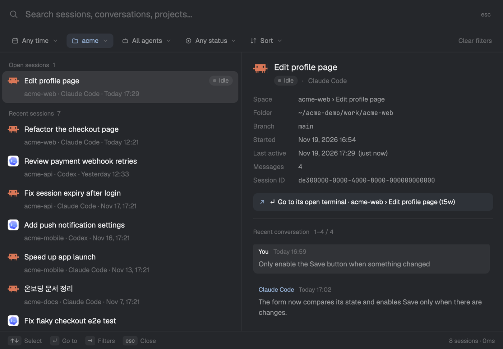
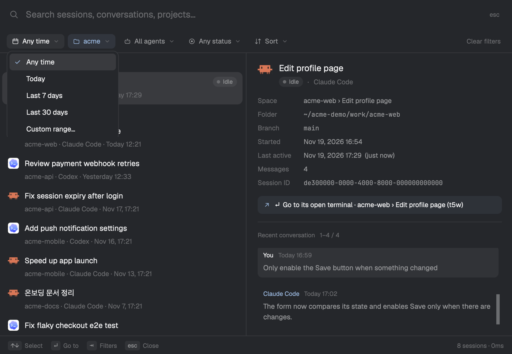
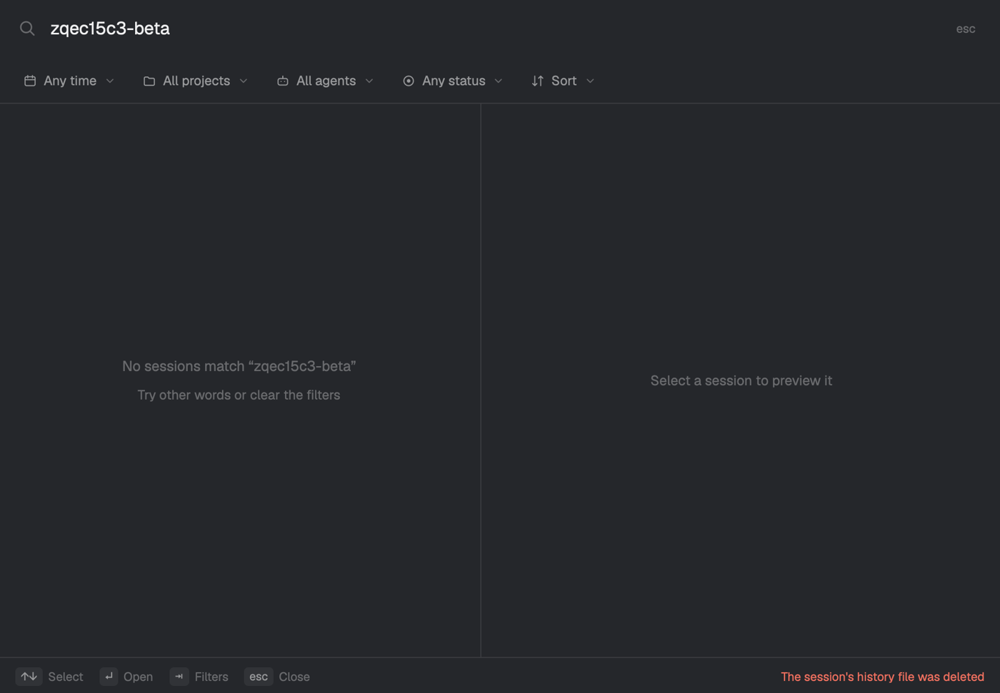

# Herdr Session Spotlight

**English** · [한국어](README.ko.md)

A Spotlight-style search for every **Claude Code** and **Codex** session on your computer, inside the
[Herdr](https://herdr.dev) app. Press `Cmd+K`, type, and jump back into any session: running sessions are
focused in their exact terminal, ended ones resume in their own folder with the agent's official resume
command (`claude --resume`, `codex resume`). Everything is indexed locally with SQLite FTS5; nothing
leaves your machine.



## Features

| | |
|---|---|
| **One search** | Session titles, your messages, agent replies, project / Herdr Space, working folder, branch, agent |
| **Matching** | Substring search (works for Korean too: "프로필" finds "프로필을"), all words must match, "quoted phrases", case-insensitive, highlighted, ranked by relevance with extra weight for titles |
| **Recent sessions** | Open Spotlight with nothing typed: *Open sessions* (an agent is alive in a Herdr terminal), then *Recent sessions* by last activity. Created and last-active times are shown separately |
| **Filter chips** | Date (today / 7 days / 30 days / any time / custom), project or Space, agent (Claude / Codex / other), status (open / ended), sort (auto / last active / created / relevance / oldest) |
| **Search operators** | `project:acme-web` `agent:codex` `after:2026-11-01` `before:2026-11-10` `after:7d` `status:running` `sort:created` |
| **Status** | Herdr's own agent status: **Working** (spinner) · **Needs input** · **Done** · **Idle** (gray: open in a terminal, doing nothing) |
| **Preview** | Metadata (project, folder, branch, started, last active, messages, session id), what Enter will do, and the conversation scrolled to the matching message |
| **Open** | An open session is focused in its Space, tab and pane; nothing new is started. An ended one resumes in its folder: a new tab in the Space it last ran in or one on that folder, else a new Space |
| **Languages** | English by default, Korean available ([below](#language)) |

| Title search | Conversation search |
|---|---|
|  |  |

| Filter menu | Going to an open session |
|---|---|
|  |  |

| No results | History deleted |
|---|---|
|  |  |

## Keys

| Key | Action |
|---|---|
| `Cmd+K` | Open / close (a Herdr global binding in `keys.json`) |
| typing | Searches as you type (60 ms debounce) |
| `↑` `↓` / `PageUp` `PageDown` | Move the selection |
| `Enter` | Go to the open terminal, or resume the ended session |
| click | Select; click the selected row again to open it |
| `Tab` / `Shift+Tab` | Walk the filter chip menus (inside a menu: `↑` `↓` choose, `Enter` apply, `←` `→` next chip) |
| `Esc` | Close the menu, then the dialog |

## Install

Requirements: the Herdr app (versions below), `python3` 3.9+ with SQLite 3.34+ (FTS5 `trigram`), macOS. No other packages.

```sh
git clone https://github.com/dltmdrbtjd/herdr-session-spotlight
cd herdr-session-spotlight
scripts/install.sh              # another key: --key cmd-shift-o · no key: --no-key
```

`install.sh`:

1. copies `session-spotlight/mods/session-spotlight/` to `~/.config/herdr-app/mods/session-spotlight/`
   (and stops if a different mod already has that name);
2. adds **one** line to `keys.json`: `"cmd-k": "mod.open:session-spotlight"`. It backs the file up first
   (`keys.json.spotlight-backup-<time>`), stops before copying anything if the key already does something
   else, edits a symlinked `keys.json` at its target with its permissions, and records the binding it added
   in `~/.config/herdr-session-spotlight/installed-keys.json` so uninstalling removes only that;
3. runs `spotlight.py doctor` (Python / SQLite / FTS5) and `herdr-app check`.

The index is built the first time Spotlight opens (about 3 s for ~200 sessions on the development machine).

> **Shortcut clashes:** a key another app registers system-wide never reaches Herdr. The Notion desktop app,
> for example, takes `Cmd+Shift+K`, which is why the default is `Cmd+K`. In-app shortcuts such as Slack's or
> Notion's `Cmd+K` only apply inside those apps and don't clash.

To have a Herdr agent add it: *"Read ~/.config/herdr-app/AGENTS.md, then add this mod: <repo>/session-spotlight"*.
`session-spotlight/RECIPE.md` is the Gallery-style build brief.

### Uninstall

```sh
scripts/uninstall.sh            # the mod folder and the binding the installer added (keys.json backed up first)
scripts/uninstall.sh --purge    # also the local index and config
```

Claude Code's and Codex's own history is never modified: not by installing, indexing or uninstalling.

## Language

The UI is English by default. Create `~/.config/herdr-session-spotlight/config.json`:

```json
{ "language": "ko" }
```

`"en"` (default), `"ko"`, or `"auto"` (the macOS system language, English when it isn't one of these).
Spotlight picks it up the next time it opens. Translations live in
`session-spotlight/mods/session-spotlight/i18n.js`; adding a language means adding one table there.
Search operators accept a few Korean aliases too (`프로젝트:`, `오늘`, `종료됨`).

## How it works

```text
session-spotlight/mods/session-spotlight/
├── main.js            Spotlight UI (a gpui-kit View): keys, filters, preview, open / resume
├── lib.js             pure logic: dates, filter → arguments, live terminals, decideOpen()
├── i18n.js            UI strings (en, ko)
├── mod.json           place: none + a centered dialog overlay (920×640)
├── icons/             the mod's own SVG icons
└── engine/            Session Search Service (Python standard library only)
    ├── spotlight.py           index | search | resolve | preview | check | stats | reset | doctor | init-config
    └── spotlight_engine/
        ├── adapters.py        Claude Code / Codex history readers (read-only)
        ├── indexer.py         incremental indexer (byte offsets, file fingerprints, one run at a time)
        ├── store.py           SQLite schema (sessions · messages · messages_fts (trigram) · herdr_seen)
        ├── search.py          query parser, operators, filters, scoring, snippets, preview, resume checks
        ├── live.py            Herdr live sessions: running terminal → session id, by process
        ├── redact.py          secret masking
        └── textutil.py        highlighting and snippets
```

Design notes and research: [docs/DESIGN.md](docs/DESIGN.md) · Verification: [docs/VERIFICATION.md](docs/VERIFICATION.md)

### Which terminal runs which session

A session's key is `machine|agent|session id` (`local` for this computer). A running terminal is matched to
its history **by process, never by title or project name**:

- **Claude Code** writes `~/.claude/sessions/<pid>.json` with its `sessionId`. Spotlight trusts it only if its
  `procStart` equals the process's own start time (`ps -o lstart`, UTC), or, for files without one, if its
  `startedAt` falls right after that start. A file left behind by a dead process whose pid was reused never
  claims a terminal.
- **Codex** keeps its rollout file open; `lsof` names it. If a process holds several main threads, or only a
  sub-agent's, it stays unidentified rather than guessed.
- Otherwise, `--resume <uuid>` / `resume <uuid>` in the running command.
- Sub-agents (`hc run` children without a pane) belong to their parent's tab, as in Herdr.

**Enter asks again every time** where the session runs, then decides:

- a terminal holds it → `space.select → tab.select → pane.focus {terminal: <exact address>}`; Spaces with the
  same name are never confused;
- none does → it checks the history file and folder still exist, then resumes;
- it starts **nothing** and says why when that check failed or a terminal is missing from the answer, when a
  terminal of the same agent couldn't be identified (for example a Claude still on its folder-trust screen),
  when the terminal holding the session can't be focused, or when the terminals changed while checking.
  Refusing is better than starting a duplicate of a running session.

## Index and privacy

- **Where:** `~/.local/share/herdr-session-spotlight/index.sqlite3` (`$XDG_DATA_HOME` is honored); folder `0700`, file `0600`.
- **Config (optional):** `~/.config/herdr-session-spotlight/config.json`; `spotlight.py init-config` writes the defaults:

  ```json
  {
    "exclude_paths": ["~/work/secret-project", "/private/tmp/*"],
    "agents": ["claude", "codex"],
    "index_assistant": true,
    "include_subagents": false,
    "include_archived": true,
    "max_message_chars": 6000,
    "language": "en"
  }
  ```
  Sessions started in an `exclude_paths` folder are not indexed, and adding a path removes ones already there.
- **What is indexed:** what you typed and the agent's text replies. Tool calls, tool output (file contents,
  command output), thinking, attachments and injected instruction blocks (`<system-reminder>`, `AGENTS.md`
  instructions, `<environment_context>`, …) are **left out**.
- **Secret masking:** before storage, API keys (`sk-…`, `AKIA…`, `ghp_…`, `xox…`, `AIza…`, JWTs, PEM private
  keys), `Bearer` tokens, values of `password=` / `api_key:` / `"password": "…"` (JSON), and passwords in URLs
  become `[REDACTED]`. This applies to messages, titles, first/last prompts and the parser state kept for
  incremental indexing; prompts are masked *before* they are shortened. Skipped and excluded files keep no
  parser state at all.
- **Network:** none. The mod only runs the local `python3` engine (`exec`).
- **Permissions:** no Full Disk Access. It reads only `~/.claude/projects`, `~/.claude/sessions`,
  `~/.codex/sessions`, `~/.codex/archived_sessions` and `~/.codex/session_index.jsonl`.
- **Delete / rebuild:** `python3 ~/.config/herdr-app/mods/session-spotlight/engine/spotlight.py reset --yes`
  (waits for a running indexer), then open Spotlight to rebuild; `index --full` rebuilds at once.
- **Remote machines:** not indexed (see limitations).

## Tested with

| Component | Version |
|---|---|
| Herdr app | 0.1.16 (herdr-core `hc` 0.1.21), macOS (Darwin 25.6, Apple Silicon) |
| Claude Code | 2.1.283 (`~/.claude/projects/*/<id>.jsonl`, `custom-title` / `ai-title` records, `sessions/<pid>.json`) |
| Codex CLI | 0.169.1 (`rollout-*.jsonl` `session_meta` / `response_item`, `session_index.jsonl`) |
| Python | 3.14.3 (Homebrew, used by default) · 3.9.6 (macOS) — engine tests pass on both |
| SQLite | 3.53.4 / 3.51.0 (FTS5 `trigram` tokenizer needs 3.34+) |

## Known limitations

- **No jumping to a message:** Claude Code and Codex can't open a conversation at a given message. The preview
  scrolls to the matching message and shows it in context instead.
- **Remote machines:** only this computer's history is indexed. Remote terminals appear among open sessions
  and can be focused, but aren't matched to sessions or searched. Supporting them needs the engine installed on
  each machine and called through `exec(..., {on: machine})`, behind an explicit opt-in (not implemented).
- **Finished Herdr terminals** (herdr-core's finished list) aren't used: ended Claude/Codex sessions come from
  the agents' own history. Other agents (pi, opencode, …) appear only while open, as "Other".
- **Resume command:** your Herdr launcher for `claude` / `codex` (`programs.json` `run`) plus the resume
  arguments. Other flags the session was first started with aren't recorded anywhere, so they aren't repeated.
- **Folder trust:** resuming in a folder the agent doesn't trust yet shows the agent's own trust screen first;
  Spotlight never answers it.
- **Archived Codex sessions** can be searched and previewed but not resumed (unarchive in Codex first).
- **One- and two-character words** can't use the trigram index and are scanned: about 50–90 ms on 180k
  messages of synthetic data.
- **Window size:** the dialog is 920×640. Below 700 px wide the preview hides; smaller windows weren't tested.
- **macOS only** so far (process lookup uses `ps` and `lsof`, `auto` language uses `defaults`).

## Development

```sh
python3 -B -m unittest discover -s tests/engine -v      # engine (51)
node --test tests/mod/*.test.mjs                          # mod logic (23)
scripts/dev-sync.sh && herdr-app check ~/.config/herdr-app/mods/session-spotlight
python3 -B scripts/bench.py --sessions 1000 --messages 40 # synthetic benchmark
scripts/drive.sh open|query <text>|down|enter|filter <kind> <value>|menu <kind>|shot <file>|close
```

`scripts/drive.sh` drives an open dialog through `herdr-app do session-spotlight.<command>` for scripted checks
in the real app. `scripts/demo-data.py` writes made-up history (acme-* projects) for screenshots.

## License and dependencies

MIT — [LICENSE](LICENSE). No runtime dependencies beyond the Python standard library, SQLite FTS5 and Herdr's
gpui-kit. The Claude and Codex icons are Herdr's own (`~/.config/herdr-app/icons/`), referenced, not included.

[herdr-omnisearch](https://github.com/dmnkf/herdr-omnisearch) (MIT) was studied for ideas (the list of
injected blocks to skip, finding Claude sessions through pid files, open Codex rollouts). No code was copied;
the UI, data model and indexing were designed independently.
