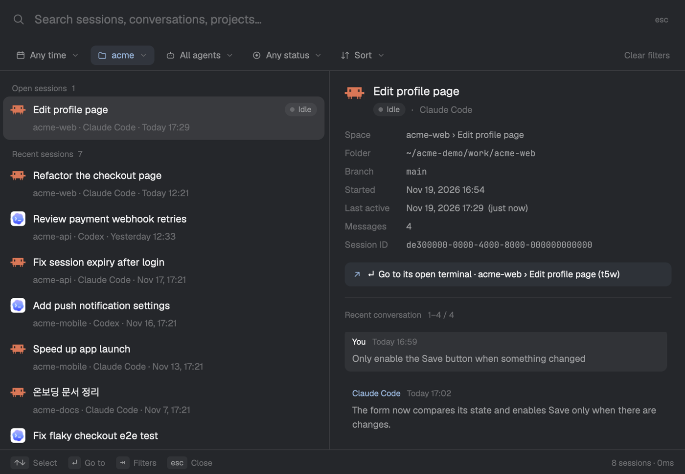

# Session Spotlight

Cmd+K opens a centered search dialog over every Claude Code and Codex session on this computer, open or ended. Type to search titles, what was said, projects and folders; with nothing typed, the sessions open in Herdr come first, then the most recent ones. Enter goes to the exact terminal a session is open in, or resumes an ended one in its own folder. Everything is indexed locally by a small Python program that ships inside the mod. English, with a Korean option.

## What you see

- A centered dialog, 920×640 px, in Herdr's own frame, with the window dimmed behind it. Nothing is added to the layout.
- **Search bar, 56px:** an 18px search glyph in `dim`, a borderless 16px field reading "Search sessions, conversations, projects…", a 14px spinner while it searches, indexes or resumes, and an `esc` cap at the right.
- **Filter chips, 40px:** five chips, each a 13px glyph, a 12px label and a chevron: "Any time", "All projects", "All agents", "Any status", "Sort". A chip whose filter is set turns `accent` on a 10% accent tint, and "Clear filters" appears at the right. A chip opens a menu right under it: 30px rows, a check on the current value, each project with its session count.
- A 1px `border` line, the body, another line, and a 34px footer: key caps "↑↓ Select", "↵ Go to" (or "Resume", "Open"), "⇥ Filters", "esc Close", and at the right "N sessions · N ms", an error in `blocked`, or a warning.
- **Left, the results**, 48% of the width (360–500px), scrolling smoothly however long:
  - With nothing typed: an "Open sessions N" section (an agent is alive in a Herdr terminal), then "Recent sessions N"; 30px headers in 11px semibold `dim`.
  - Rows are 58px (78px with a snippet), 6px in, 9px radius. Line 1: the agent's icon (20px; Claude Code's and Codex's from Herdr, else a terminal glyph on `hover`), the title at 13.5px with matched words in `accent` semibold, and for an open session a status pill: "Working" with a spinner in `working`, "Needs input" in `blocked`, "Done" in `done`, or a quiet gray "Idle" (a dot in `idle`, text `muted`, on `hover`). An idle agent never looks busy. Archived Codex sessions say "Archived". Line 2, 12px `dim`: "Space or project · agent · Today 14:32". Line 3 only when the words matched the conversation and aren't all in the title: "You" or "AI", then one line starting just before the first match, matches in `accent`.
  - The selected row is on `selected`, a hovered one on `hover`.
- **Right, the preview** (hidden below 700px width): the icon (26px) and the title (15.5px semibold, at most two lines), the status pill and the agent; rows for Project or Space, Folder (in the terminal font), Branch, Started, Last active (with "3 h ago"), Messages and Session ID; a 32px bar on an accent tint saying what Enter will do ("↵ Go to its open terminal · space › tab (t12)", "↵ Resume in a new tab · claude --resume 1a2b3c4d…", or "Can't resume · why" in `blocked`); then "Matching conversation" or "Recent conversation" with the message range, and the messages, opened on the matching one: yours on `hover` headed "You", the agent's headed by its name in `accent`, the matching one outlined in `accent` with its matching words on a 25% accent tint.
- Empty states, centered in `dim`: loading, first indexing, "No sessions match “…”", or nothing for these filters, with a "Clear filters" button when filters are on.
- **Language:** English. With `"language": "ko"` (or `"auto"` on a Korean system) in `~/.config/herdr-session-spotlight/config.json`, every label, date and relative time is Korean.

## How it behaves

- It opens on the last list at once, with the field focused, while it checks which sessions are open, catches up on new history and searches. Typing searches 60 ms after the last key; only the newest answer counts. Open sessions are re-checked every 4 s while it's open.
- ↑/↓ and Page Up/Page Down move the selection, skipping headers, scrolling only as far as needed. A click selects; clicking the selected row opens it. Tab and Shift+Tab walk the chip menus; in a menu ↑/↓ choose, Enter applies, ←/→ go to the next chip, Esc closes the menu. Esc closes the dialog.
- Typed operators narrow further and show in their chip: `project:` (part of a project or Space name), `agent:claude|codex|other`, `after:` / `before:` (`YYYY-MM-DD`, `today`, `7d`, `2w`), `status:running|ended`, `sort:recent|created|relevance|oldest`. "Custom range…" in the date menu writes `after:<a week ago> before:<today>` into the field with the first date selected.
- **Enter always checks again** where the session is open right now. It starts nothing, and says why in the footer, if that check fails or misses a terminal, if a terminal of the same agent can't be identified, or if the terminal holding the session can't be focused.
- **The session is open:** Herdr shows that exact terminal, in its Space and tab, even when another Space has the same name. A sub-agent without a pane is shown the way Herdr shows sub-agents. Nothing new is started.
- **The session has ended:** if its history file or folder is gone, it says so and drops it from the list. Otherwise it resumes the session with the agent's own command (`claude --resume <id>`, `codex resume <id> -C <folder>`, after the person's own launcher for that agent) in a new tab named after the session, in the Space it last ran in, else a Space on its folder, else a new Space there. The same session can't be started twice within 15 s, and a toast confirms.

## Built from

- **One mod**, `mods/session-spotlight/`: `main.js` (the View), `lib.js` (pure helpers, tested with node), `i18n.js` (en, ko strings), `mod.json` (`place: "none"`, `overlay: {kind: "dialog", width: 920, height: 640}`), `icons/*.svg`, and `engine/` (Python 3.9+ standard library).
- **A `keys.json` snippet**: `"global": {"cmd-k": "mod.open:session-spotlight"}`. (Not Cmd+Shift+K: the Notion desktop app takes that one system-wide, so it never reaches Herdr.)
- **Herdr functions:** `exec`, `knownAgents`, `terminals`, `agents`, `panes`, `spaces`, `run`, `notify`, `theme`, `settings`, `props`, `closeOverlay`, `appHome`, `checking`, `nextCommand`.
- **Commands:** going to an open session is `space.select`, `tab.select`, `pane.focus {terminal}` with its exact address (a sub-agent without a pane: `agent.focus`; anything else: `terminal.peek`). Resuming is `tab.new {space, folder, argv, name}` or `space.new {folder, argv, tab}`, with `argv` = the agent's `run` from `knownAgents()` (programs.json) plus the resume arguments.
- **UI pieces:** `InputState` + `Input` with the placeholder drawn behind it (so it follows the language), chip menus as `Popup.new(id, chip).anchor("top_left").content(menu)`, the results as a `v_virtual_list` with per-row heights and one `on_item_click`, the preview's messages in an `overflow_y_scrollbar` area moved with a `ScrollHandle`. The last list is kept in module scope so the next open paints at once. `lib.js` holds the pure logic (`decideOpen()` decides what Enter does on a fresh `resolve` answer), `i18n.js` the en/ko strings.
- **The engine**, run as `python3 -B -I -S engine/spotlight.py <command>`, prints one JSON object:
  - `index`: incremental. Each history file's size, mtime, byte offset and parser state are kept; unchanged files are skipped, grown files are read from the offset, shrunk or rewritten ones re-read, deleted ones dropped. One indexer at a time (`flock`).
  - `search --query --agent --project --since --status --sort --limit --live <json>`: results with `title_segments`, `snippet.segments` (`[text, matched]` pairs, so JS never maps offsets), `running`, `resumable`, `why_not`, `resume_args`, and `facets.projects`.
  - `resolve --terminals <json>`: terminal address → session id by process: Claude `~/.claude/sessions/<pid>.json` whose `procStart` equals `ps -o lstart` in the C locale and UTC; Codex by `lsof` on the open `rollout-*.jsonl`; else `--resume <uuid>` in argv. Also records the Space each session ran in (`herdr_seen`).
  - `preview --key --query --message`, `check --key`, `stats`, `reset --yes`, `doctor`, `init-config`.
- **Index:** `~/.local/share/herdr-session-spotlight/index.sqlite3` (0600): `sessions` (one per agent session, integer id), `messages` (id, session id, role, time — narrow on purpose), `messages_fts` (FTS5 `trigram`, the text), `sources`, `herdr_seen`, `meta`. Words of 3+ characters use the FTS index; shorter ones scan.
- **What is indexed:** user and assistant text only. Tool calls and results, thinking, attachments, meta/compact records, sidechains and injected instruction blocks are skipped; secrets are masked before storage, titles included.

## Watch out

- **Tell the person before adding it.** It runs programs on this computer only: `python3` (its engine, inside the mod folder), `ps` and `lsof` (to see which terminal runs which session) and, for `"language": "auto"`, `defaults`. It reads Claude Code's and Codex's history without changing it (`~/.claude/projects`, `~/.claude/sessions`, `~/.codex/sessions`, `~/.codex/archived_sessions`, `~/.codex/session_index.jsonl`). It writes only its index (`~/.local/share/herdr-session-spotlight/`, 0600) and its config folder (`~/.config/herdr-session-spotlight/`), and asks for one `keys.json` binding (`cmd-k`). No network access.
- `herdr-app check` runs `init()`: the mod returns early under `checking()`.
- Never write into the mod folder at run time: a saved file there reloads the mod. The engine runs with `-B` (no `__pycache__`), and the index lives under `~/.local/share`.
- `v_virtual_list` rows can't have handlers: use `on_item_click(key)` on the list. Rows need fixed heights (`items.map(itemHeight)`).
- An absolutely positioned dropdown inside the dialog didn't paint; `Popup.new(id, trigger).anchor("top_left").content(...)` paints in a layer above.
- `Tab` is bound by the app; `cx.bind_keys([{keystroke: "tab", action, context}])` with the root's `.key_context(context).on_action(action, …)` wins.
- `on_size_change` reports window pixels: divide by `settings().zoom`.
- Claude writes `procStart` in UTC and the C locale; run `ps` with `TZ=UTC LC_ALL=C` or the comparison never matches on a non-English system.
- Claude records' `cwd` follows the shell's `cd` during a session: the first one is where the session started and where it must resume.
- A sub-agent's `herdr.space`/`herdr.tab` labels can name another space; place it by its parent's pane.
- Decide a terminal's agent by program name (argv[0], or what a launcher shell runs), never by substring: `-C /private/tmp/claude-501/…` is not Claude.
- A trust dialog in a new folder belongs to the agent; the mod doesn't answer it.
- `herdr-app do session-spotlight.<command>` reaches the open dialog only; command names can't carry `:value`, so scripted checks hex-encode (`query-<hex>`).

## Done when

- `herdr-app check mods/session-spotlight` passes and `python3 mods/session-spotlight/engine/spotlight.py doctor` reports `"fts5_trigram": true`.
- Cmd+K opens the dialog with the field focused; Esc closes it.
- With nothing typed, the open sessions come first with their real status (only working agents spin), then the rest by last activity, each with project · agent · time.
- A word from a session's title lists it first; a word only said in a conversation lists it with a highlighted snippet, and the preview opens on that message.
- `agent:codex`, a date chip, the project chip and each sort change the list as named.
- Enter on an open session focuses its exact terminal, also when two Spaces share a name, and the number of terminals doesn't change.
- Enter on an ended Claude Code or Codex session starts its resume command in its own folder, and that new terminal is then listed as that same session, open.
- Enter on a session whose history file was deleted shows a warning and starts nothing.
- With `"language": "ko"`, every label is Korean the next time it opens.
